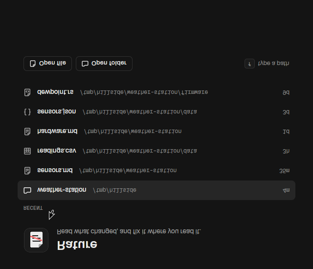
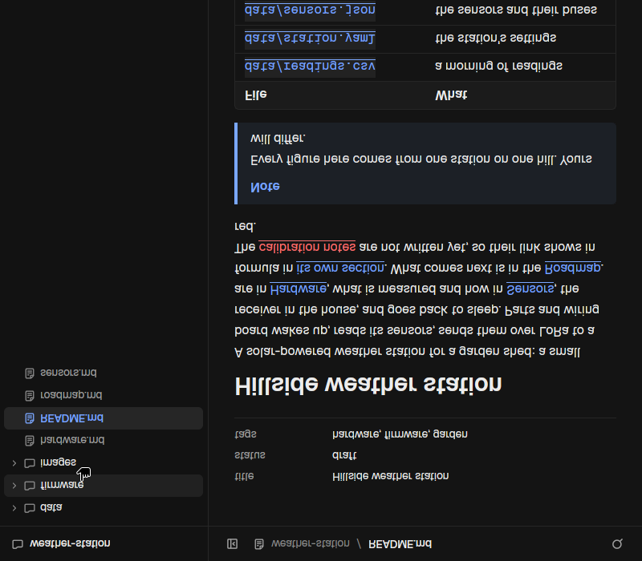
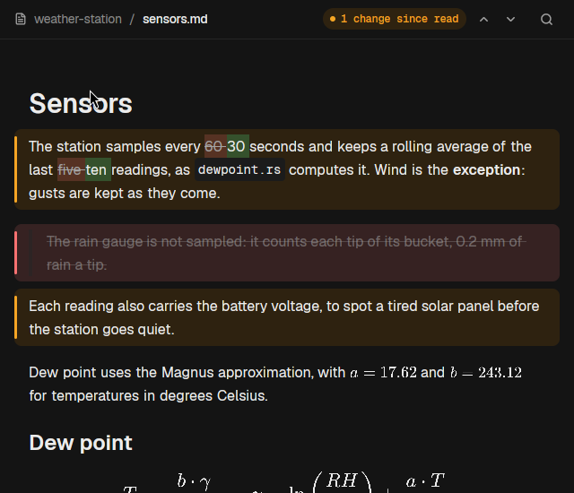

# Rature

A minimal Markdown reader you can also edit in place, for proofreading what an agent (or anyone)
writes. Native, keyboard first, no webview.

## What it does





- **A file or a folder**: `rature file.md` or `rature folder/`. A folder shows a tree (left or
  right), ignoring what `.gitignore` ignores, and opens its README. One window: opening another
  file sends it there. Started without one, the window lists the recent files and folders, with
  buttons to the desktop's file chooser (XDG portal). `f` there, or `O` at any time, opens one by
  its path, Tab completing it.
- **No trace in the folder**: config in `~/.config/rature/config.toml`, reading positions, recent
  files and read snapshots in `~/.local/state/rature`.
- **Markdown**: tables, task lists, footnotes, highlighted code (copy button), Mermaid diagrams,
  math (inline and display), YAML front matter, GitHub alerts. Diagrams and code are drawn in the
  background.
- **Other formats, read only**: JSON and YAML as foldable trees, CSV as a table, images, code
  highlighted by extension. Binary files and files over 10 MB are refused.
- **Links**: relative links to files and anchors, back and forward, an outline. Broken links are
  red. Clicking a heading copies its link (`file.md#slug`).
- **Search**: in the file (`Ctrl-F`), across the folder through ripgrep (`s`), files by a few letters
  (`f`, recent first).
- **Live reload**: written in place or replaced by a rename, the file is read again where you are.
- **What changed**: since the last read (or against git `HEAD`), block by block: new blocks green,
  changed ones yellow with their changed words, removed ones struck in red. The first opening
  takes the snapshot; `m` marks the current state read.
- **Edit in place**: double-click a block, or `i` for the block at the top, and its Markdown opens
  where it was. Saved 800 ms after you stop typing; `Ctrl-s` saves and formats (Markdown by
  dprint, JSON pretty-printed).
- **Theme**: Flottille's own colours, or the current Omarchy theme, followed live: a theme
  change cross-fades the open window, formulas and diagrams drawn again in its colours.

## Config

`~/.config/rature/config.toml`, every key optional:

```toml
tree = "left"            # or "right"
tree_width = 260
column = 760             # reading width
font = "Noto Sans"       # the text read
code_font = "Geist Mono" # code, bundled
font_size = 16
```

## Stack

Rust and GPUI through gpui-kit, as Flottille. No webview. The window is built from Flottille's
own components (`src/ui/`, copied from `flottille-ui`): its colours, Geist and Geist Mono
(bundled, SIL OFL), Lucide icons, buttons, rows, the search modal, toasts, and its motion
(entrances that rise and fade in, hovers and choices that fade, rows that fold, a theme that
cross-fades). Markdown parsed by `markdown` (mdast)
and drawn by our own elements; Mermaid by `mermaid-rs-renderer` and math by RaTeX, both to SVG;
syntect with two-face for code; `similar` for the diff; `notify` to follow files; `nucleo` for
the file finder; dprint for Markdown formatting.

## Installing

`./install.sh` builds this clone and installs `rature` into `~/.local/bin`, with `rt` a link to
it, and adds Rature to the application launcher (entry and icon in `$XDG_DATA_HOME`). Run it
again to update. Started from the launcher, without a file, it shows the recent files and
folders.

## Using

`rature file.md` (or `rt file.md`) opens the file and gives the terminal back. With a window
already open, the file goes to it. The file is followed: written in place or replaced by a
rename, as an agent does, it is read again where you are.

| Keys | |
|---|---|
| `j` `k`, arrows | line down, up |
| `Ctrl-d` `Ctrl-u` | half a page |
| `Space` `Shift-Space`, `Ctrl-f` `Ctrl-b` | a page |
| `gg` `G`, `Home` `End` | top, bottom |
| `Ctrl-F`, `n` `N`, `Esc` | search the file, next and previous hit, clear |
| `f`, `Ctrl-p` | find a file (with nothing open: open one) |
| `O` | open a recent file or folder, or a path (`Tab` completes) |
| `s`, `Ctrl-Shift-f` | search the folder (ripgrep) |
| `o` | outline |
| `Ctrl-o` `Ctrl-i`, `Alt-Left` `Alt-Right` | back, forward |
| `]c` `[c` | next, previous change |
| `m` | mark read |
| `D` | compare with the last read or with git `HEAD` |
| `i`, double-click | edit a block; `Esc` or `Ctrl-Enter` to stop |
| `Ctrl-s` | save and format |
| `zM` `zR` | fold, unfold every JSON or YAML node |
| `Ctrl-=` `Ctrl--` `Ctrl-0` | zoom |
| `t` | show, hide the tree (or the button at the corner of the bar) |
| `Ctrl-h` `Ctrl-l` | to the tree, to the page |
| tree: `j` `k` `l` `h`, `Enter` | move, open, close |
| `e` | the file in nvim, in the desktop's terminal (`xdg-terminal-exec`) |
| `q` | quit |

## Development

`tools/capture.sh <file-or-folder> <out.png>` captures the window in a nested headless Weston,
never the user's session, with its own `HOME` and XDG folders, and prints the start-up timing.
`KEYS` types keys into it first, `THEN` runs a command afterwards (to change the file, say),
`OMARCHY=1` uses a copy of the current Omarchy theme. `examples/specs/` covers every view.

First frame: about 170 ms for a file, 175 to 230 ms for a folder (release build, headless Weston).

## Limits

- Editing is per block: the block's Markdown opens in place, not a live preview around the cursor.
- "What changed" covers Markdown files. A paragraph holding math is shown old and new, not word
  by word. Your own edits count as changes until `m`.
