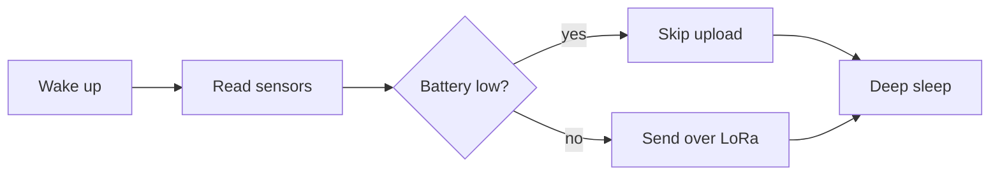

# Sensors

The station samples every 60 seconds and keeps a rolling average of the last five readings, as
`dewpoint.rs` computes it. Wind is the **exception**: gusts are kept *as they come*.

> The rain gauge is not sampled: it counts each tip of its bucket, 0.2 mm of rain a tip.

Dew point uses the Magnus approximation, with $a = 17.62$ and $b = 243.12$ for temperatures in
degrees Celsius.

## Dew point

$$
T_d = \frac{b \cdot \gamma}{a - \gamma}, \quad \gamma = \ln\left(\frac{RH}{100}\right) + \frac{a \cdot T}{b + T}
$$

## Reading loop



## Checklist

- [x] Temperature and humidity
- [x] Pressure
- [ ] Wind
  - speed from the cups
  - direction from the vane
- [ ] Solar panel voltage

| Sensor | Bus | Interval (s) | Accuracy |
|--------|-----|-------------:|---------:|
| Temperature and humidity | I2C | 60 | ±0.5 °C |
| Barometer | I2C | 60 | ±1 hPa |
| Anemometer | pulse | 5 | ±0.5 m/s |
| Wind vane | analog | 5 | ±22.5° |

```rust
fn dew_point(t: f64, rh: f64) -> f64 {
    let (a, b) = (17.62, 243.12);
    let gamma = (rh / 100.0).ln() + a * t / (b + t);
    b * gamma / (a - gamma)
}
```
