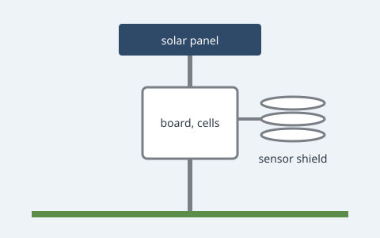

# Hardware

Everything fits in a ventilated box under a small solar panel. Back to the [overview](README.md),
or on to the [sensors](sensors.md#checklist).



## Parts

| Part | Qty | Notes |
|------|----:|-------|
| Microcontroller board with LoRa | 1 | any 868 MHz board with deep sleep |
| Temperature and humidity sensor | 1 | I2C, address `0x76` |
| Cup anemometer and wind vane | 1 | sold as a pair |
| Tipping-bucket rain gauge | 1 | reed switch, one pulse a tip |
| 6 V solar panel | 1 | 2 W is plenty in summer |
| 18650 cell and holder | 2 | wired in parallel |
| Radiation shield | 1 | stacked plates, printed or bought |

> [!WARNING]
> Keep the temperature sensor out of the sun: inside the box, it reads up to 8 °C too warm on a
> clear afternoon.[^shield]

## Wiring

- Sensor `SDA` and `SCL` to the board's I2C pins, with 4.7 kΩ pull-ups.
- Anemometer to `GPIO 14`, counted by interrupt.
- Wind vane to `ADC 1`, through a 10 kΩ divider (its readings: [Sensors](sensors.md#sensors)).
- Rain gauge to `GPIO 27`, which also wakes the board.

## Flashing

```sh
cd firmware
cargo build --release
espflash flash --monitor target/release/hillside
```

A quick look at the serial output from a laptop:

```python
import serial

with serial.Serial("/dev/ttyUSB0", 115200, timeout=5) as port:
    for line in port:
        print(line.decode().strip())
```

[^shield]: Measured side by side with a shielded sensor, in July.
